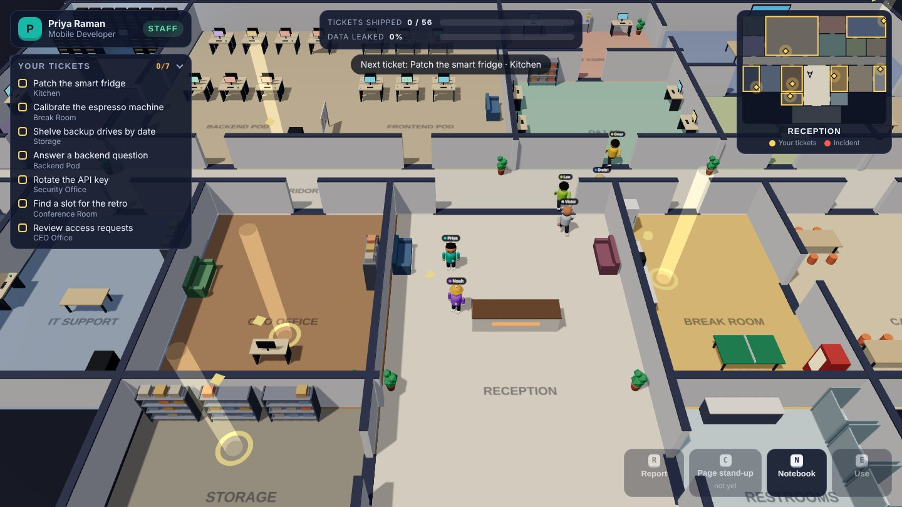
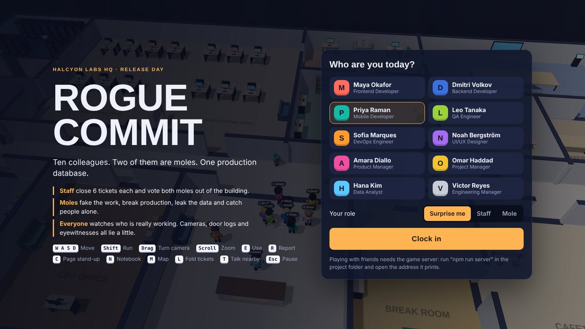
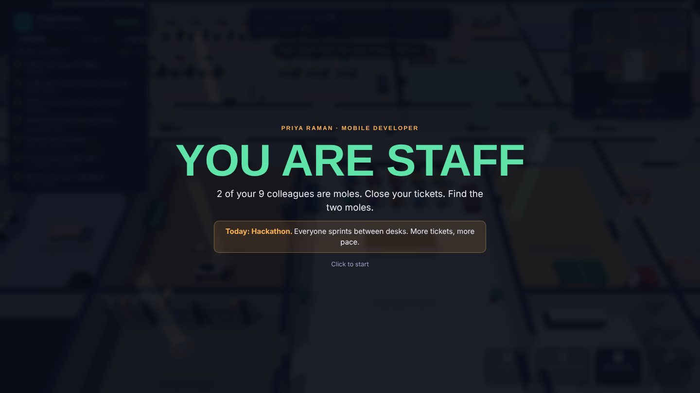
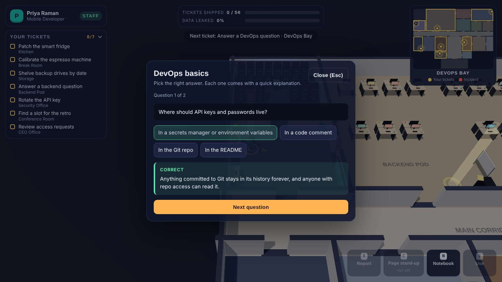
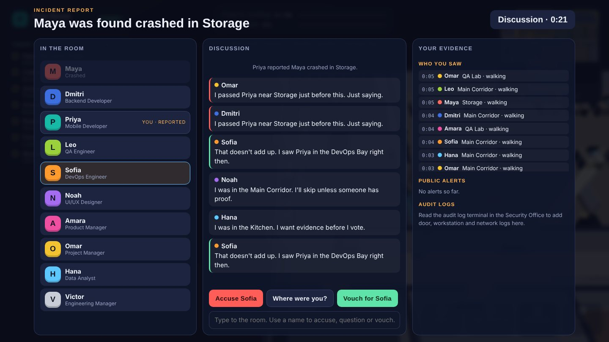
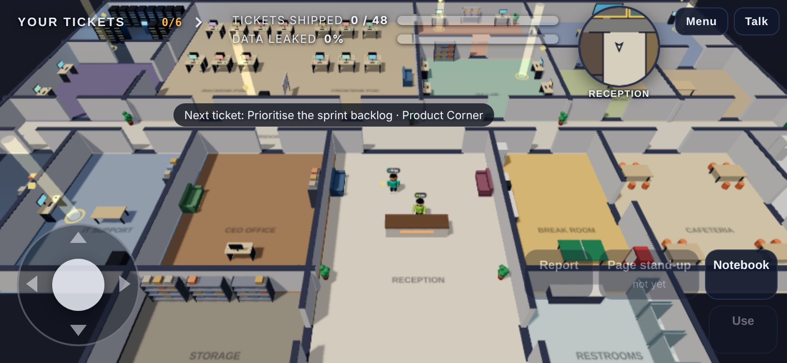
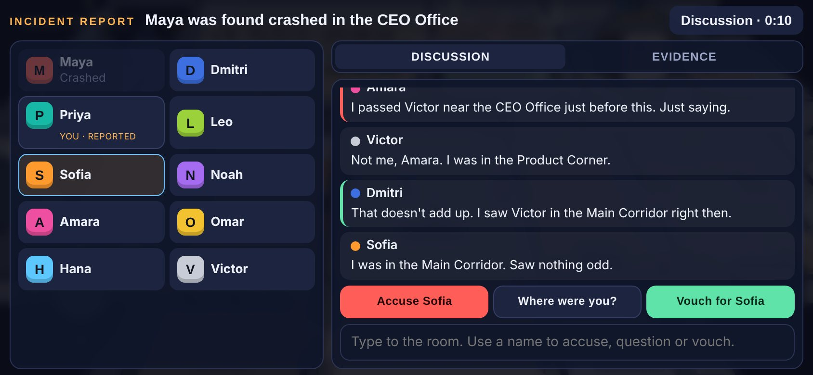

# Rogue Commit

A 3D social-deduction game set in a software office. Ten colleagues, two of them moles.
Single player with nine AI colleagues; Three.js, no other runtime dependencies.

Play it at https://rogue-commit.onrender.com (free hosting: the first load after a quiet spell can take up to a minute).



## Screenshots

| | |
| --- | --- |
|  |  |
| **Main menu.** Pick a colleague and a role, or let the game deal one. | **Role reveal.** Each match draws a day (here Hackathon) that tweaks the rules. |
|  |  |
| **Learning tickets.** Beginner backend, frontend and DevOps questions, each with a short explanation. | **Incident report.** Accuse, question or vouch, then vote someone out. |
|  |  |
| **On a phone.** Landscape only: thumbstick, round minimap, tickets and progress in one row. | **Incident report on a phone.** Colleague grid with discussion and evidence tabs. |

## Run it

```
npm install
npm run build        # writes dist/index.html + dist/game.js
npx serve dist       # or open dist/index.html directly
npm test             # 200 headless AI-only matches: crash, stall and balance check
npm run server       # multiplayer: builds, then hosts the game on port 8080
```

## Multiplayer

`npm run server` prints two addresses. Open the first on the host machine, press **Create a room**,
and give friends on the same Wi-Fi the second address plus the four-letter room code. Up to 10 humans;
every unclaimed character is played by the AI, and a player who drops is taken over by the AI.

To play over the internet, run the same server on any Node host (or behind a tunnel) and share that address.
`PORT=3000 npm run server` changes the port.

The server (`server/server.mjs`) runs the same `Game` class as single player. `src/net/protocol.js`
defines what each player is sent (own role and tickets only; roles are revealed at the end) and
`src/net/client.js` mirrors that state in the browser, predicts your own movement and smooths everyone else's.

## Controls

WASD move · Shift run · drag to turn the camera · scroll to zoom · E use · R report ·
C page a stand-up · N notebook · M map · T talk nearby · Esc pause.
Moles also get Q eliminate · F steal data · X toolkit.

On phones and tablets the game switches to touch controls automatically: a thumbstick (push to the edge to run),
drag to turn the camera, pinch to zoom, on-screen action buttons, and Pause / Map / Talk buttons. Landscape works best.
The ticket list folds to one line: tap its header, or press L on a keyboard.

## How the code is split

| Folder | What lives there |
| --- | --- |
| `src/data` | All content: settings, cast, personalities, sabotages, win rules (`config.js`), the office (`map.js`), the task catalogue (`tasks.js`) |
| `src/sim` | The match itself. No DOM, no rendering. `game.js` (state, commands, events), `ai.js` (perception, memory, behaviour), `meeting.js` (discussion and voting), `nav.js` (collision grid, sight lines, A*) |
| `src/render` | Three.js: `world.js` builds the office from map data, `characters.js` builds the cast, `view.js` owns cameras and per-frame sync |
| `src/ui` | HUD, minigame framework, meeting screen, menus, audio |
| `src/net`, `server` | Multiplayer: wire format, browser client, Node game server |
| `src/main.js` | Frame loop; turns keys into sim commands and sim events into UI |

The sim only changes through `game.command(agentId, { type, ... })` and only reports through
`game.bus` events. Multiplayer sits on that seam: the server runs `Game`, clients send commands
and render from events and snapshots. Nothing in `src/sim` knows whether an agent is a human or an AI
beyond the `isHuman` flag that skips the AI brain.

## Adding things

- **Task**: add an entry to `TASKS` in `src/data/tasks.js` (stations, minigame name, content generator).
- **Minigame**: add a function to `GAMES` in `src/ui/minigames.js`; it receives `(body, params, win, miss)`.
- **Sabotage**: add an entry to `SABOTAGES` in `config.js` and a repair generator to `FIXES` in `tasks.js`.
- **Character or personality**: add to `CHARACTERS` / `PERSONALITIES` in `config.js`.
- **Win rule**: add to `WIN_CONDITIONS` in `config.js`.
- **Map**: export another object shaped like `MAP` in `map.js` and pass it to `new Game({ map })`.

## Not built yet

Voice chat, rejoining a match after a disconnect, positions hidden from modified clients, door locks and lights-out sabotages, AI use of the camera wall,
and more task variety. The spec's full task and sabotage lists are larger than this first slice.
